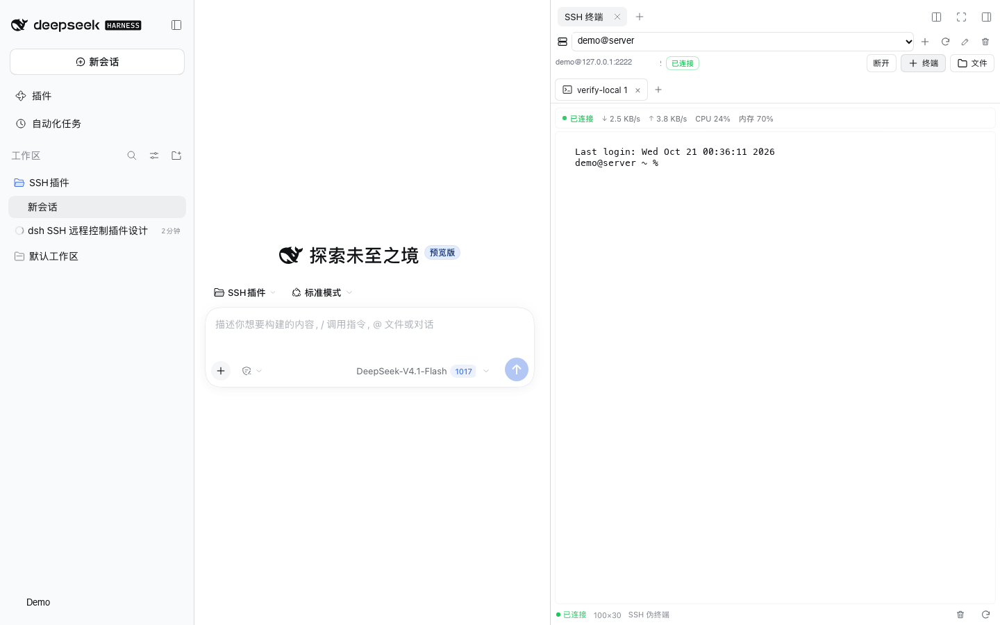
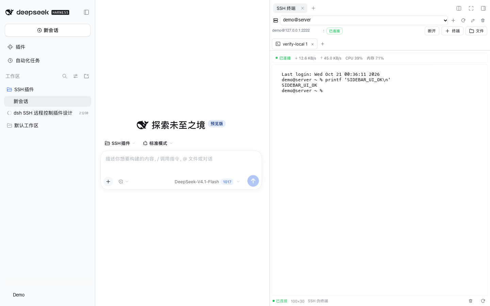
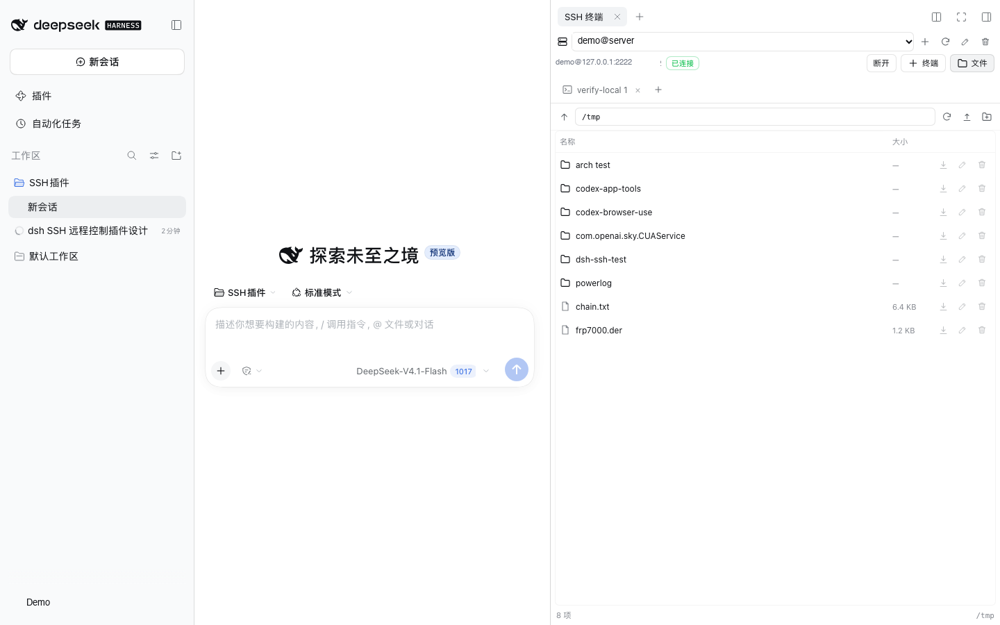
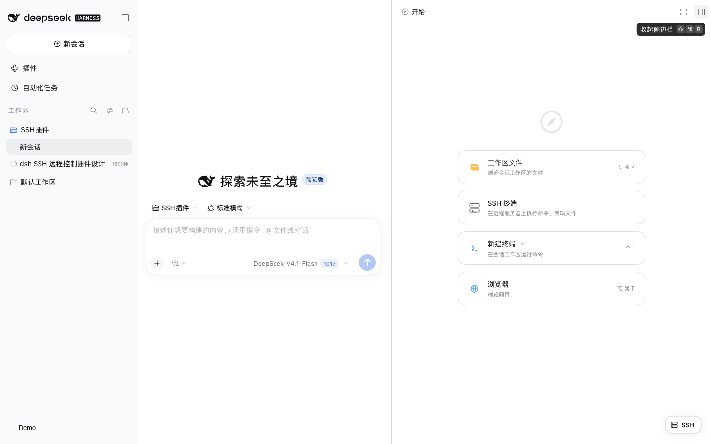

# DSH SSH

SSH for [DeepSeek Harness](https://github.com/deepseek-ai/deepseek-harness): a right-sidebar terminal, SFTP file manager, live remote metrics, and agent tools that can operate remote servers.

[中文文档](README.md)

> Unofficial community plugin, not affiliated with DeepSeek. Screenshots use demo data and contain no real connections or credentials.



## Features

- **Right-sidebar terminal, chat stays visible** — open SSH as a tab in the right sidebar; the main conversation remains usable on the left. Collapse the sidebar and the shell keeps running on the Host.
- **Interactive terminal** — xterm.js with colors, Ctrl shortcuts, resize and scrollback; multiple shells per connection.
- **Live status bar** — connection state, download/upload throughput, remote CPU and memory, refreshed about every 2 seconds while the terminal is visible.
- **Multi-connection manager** — name, host, port, username; password, private key or SSH agent; status, errors and pinned host-key fingerprints.
- **SFTP file manager** — browse, upload (multi-select or drag-and-drop), download, rename, delete, create folders.
- **Folder archive download** — download an entire remote directory as a streamed `.tar.gz`.
- **Transfer progress** — live progress bars with byte counts and a cancel button for uploads, downloads and archives.
- **Agent remote control** — `ssh_exec`, `ssh_upload`, `ssh_download`, `ssh_files`, `ssh_list`, `ssh_connect`.
- **Automatic zh/en** — follows the DSH language setting and updates in place, without a reload.
- **Security-minded defaults** — host keys are pinned on first use; credentials never leave the Host; browser requests reuse DSH's authenticated `/api` transport.

| Terminal | Files |
| --- | --- |
|  |  |

The right-sidebar entry appears in the sidebar's **+** guide:



## Requirements

- DeepSeek Harness 0.2.x (Web or Desktop)
- A remote SSH server
- For development: Node.js, pnpm, and a C/C++ toolchain only if your platform needs to build `ssh2`'s optional native addon (the pure-JS path works without it)

## Download

Latest release: [GitHub Releases](https://github.com/Callay02/dsh-ssh/releases/latest). The asset is a local DSH bundle tarball (`.tgz`); the npm package is `dsh-ssh-plugin`.

After downloading `dsh-ssh-0.1.0.tgz`, pass its absolute path as the `target` of `plugin_manager` `install_bundle`, or unpack it and follow Method B.

## Installation

The plugin is published as `dsh-ssh-plugin` on npm and can also be linked from source.

### A. Install from npm (recommended)

In a profile where `plugin_manager` is available, ask the agent:

```text
Install this npm package with plugin_manager install_bundle:
dsh-ssh-plugin
```

Or add it manually in `$DSH_PROFILE_DIR`:

```sh
pnpm add dsh-ssh-plugin
```

Without `plugin_manager`, append the Host row to `$DSH_PROFILE_DIR/cordis.patch.yml`:

```yaml
- insert:
    - id: ssh
      name: 'dsh-ssh-plugin'
```

Then refresh the page. The SSH button appears at the bottom-right; the sidebar guide also gains an **SSH terminal** card.

### B. Link from source

Clone and build the browser bundle first:

```sh
git clone https://github.com/Callay02/dsh-ssh.git
cd dsh-ssh
pnpm install
pnpm run build
```

DSH Desktop manages its `desktop` profile exclusively, so the `dsh plugin` CLI cannot modify it. Use this fallback:

1. Add the package to the profile manifest (`$DSH_PROFILE_DIR/package.json`), after backing it up:

   ```json
   {
     "dependencies": {
       "dsh-ssh-plugin": "link:/absolute/path/to/dsh-ssh"
     }
   }
   ```

2. Run `pnpm install --ignore-scripts` in the profile directory.

3. Append this row to `$DSH_PROFILE_DIR/cordis.patch.yml`:

   ```yaml
   - insert:
       - id: ssh
         name: 'dsh-ssh-plugin'
   ```

4. Reload the page or restart the desktop app.

> Editing the profile writes outside the workspace. Back up `package.json`, `pnpm-lock.yaml` and `cordis.patch.yml` first.

## Usage

1. Click **SSH** at the bottom-right, or right-sidebar **+ → SSH terminal**.
2. Select an existing connection or click **+** to create one. **Test connection** validates before saving.
3. Click **Connect**, then **+ Terminal**; the chat is still available in the center column.
4. Use the **Files** button (folder icon with the word “Files”/“文件”) to browse SFTP, or the download icon on a folder row to download it as a `.tar.gz`.
5. The sidebar can be collapsed, widened or presented fullscreen. A collapse stops terminal polling but the shell keeps running on the Host; expand it again to recover the output buffer.
6. The first successful connection pins the host key (TOFU). A later mismatch refuses the connection until you explicitly forget the key in the edit form.

### Terminal status bar

```text
● Connected   ↓ 2.2 KB/s   ↑ 4.5 KB/s   CPU 23%   MEM 70%
```

- **Network**: remote interface counters, converted to download/upload rates.
- **CPU / memory**: remote usage; hover for total memory details.
- **First sample**: CPU and network rates show `—` until a second sample exists.
- **Coverage**: Linux (`/proc/stat`, `/proc/meminfo`, `/proc/net/dev`) and macOS (`sysctl`, `vm_stat`, `top`/`ps`, `netstat`). Other Unix variants may show partial values or `—`.
- The probe runs over the existing SSH connection only while the terminal tab is visible. It never opens a port and never auto-connects.

### File transfers

- Uploads use XHR upload progress; downloads use XHR download progress and save through a Blob URL.
- A progress bar shows the file name, percentage (or transferred bytes when the total is unknown), and a cancel button.
- Folder archives have no `Content-Length`, so they use an indeterminate progress animation.
- Downloads are buffered in browser memory before saving; very large files or folders need corresponding free memory. Folder archives require the remote host to have `tar`.

## Agent tools

| Tool | Purpose | Main parameters |
| --- | --- | --- |
| `ssh_list` | List configured connections, status and fingerprints | — |
| `ssh_connect` | Pre-connect or disconnect | `connection`, `disconnect` |
| `ssh_exec` | Run one non-interactive command | `connection`, `command`, `timeoutMs`, `pty` |
| `ssh_files` | List a remote directory over SFTP | `connection`, `path` |
| `ssh_upload` | Upload a local file or directory | `connection`, `localPath`, `remotePath`, `recursive` |
| `ssh_download` | Download a remote file or directory | `connection`, `remotePath`, `localPath`, `recursive` |

Example prompts:

```text
List my SSH connections, connect to web-1, and run df -h and systemctl status nginx.
Upload local dist/ to /var/www/app/ on web-1, then restart the service.
Download /var/log/nginx/error.log into the workspace.
```

Agent-side constraints:

- Local upload/download paths must stay inside the current Session working directory; the plugin does not bypass DSH's filesystem sandbox.
- The Agent can only use connections the user configured; it cannot create connections or read stored secrets.
- Recursive directory transfers skip `.git` and `node_modules` and cap one run at 1000 files.

## Configuration

Add a `config` block to the `ssh` row in `cordis.patch.yml` (all fields optional):

```yaml
- id: ssh
  config:
    dataDir: ~/.dsh/ssh
    connectTimeoutMs: 20000
    execTimeoutMs: 120000
    maxOutputChars: 131072
    maxTerminalChars: 524288
    maxTerminals: 8
    keepaliveIntervalMs: 15000
```

| Field | Default | Meaning |
| --- | --- | --- |
| `dataDir` | `$DSH_HOME/ssh` | Directory containing `connections.json` |
| `connectTimeoutMs` | `20000` | SSH handshake timeout |
| `execTimeoutMs` | `120000` | Default `ssh_exec` timeout |
| `maxOutputChars` | `131072` | Per-stream output cap for `ssh_exec` |
| `maxTerminalChars` | `524288` | Scrollback retained per interactive terminal |
| `maxTerminals` | `8` | Maximum live terminals per connection |
| `keepaliveIntervalMs` | `15000` | SSH keepalive interval |

## Security model

- **Credentials**: stored in `$DSH_HOME/ssh/connections.json`, directory `0700`, file `0600`. Passwords and passphrases are currently plaintext protected only by file permissions; prefer a private key or SSH agent, and keep disk encryption enabled.
- **Host keys**: SHA-256 fingerprint pinned on first successful connection (TOFU). A mismatch blocks the connection until the user resets the key.
- **Browser API**: routes live under DSH's `/api` and inherit its signed-cookie authentication and Host/Origin checks. No additional port or unauthenticated route is opened.
- **No secret leakage**: list responses expose only `hasPassword` / `hasPassphrase`, never the secret itself.
- **Agent authority**: the Agent can run arbitrary commands on connections you configure. Only add servers you intend to delegate, and use limited accounts where appropriate.

## Privacy checks

The repository must not contain real connections, credentials or personal identifiers. A local Git hook and a GitHub Actions workflow check the staged tree; new or changed screenshots must be redacted and recorded in `privacy/approved-images.txt`.

```sh
git config core.hooksPath .githooks
sh scripts/check-privacy.sh --all
```

See [PRIVACY.md](PRIVACY.md).

## Architecture

```text
Browser (right sidebar tab)                 Host process (Cordis plugin)
  connection manager                         SshManager
  xterm terminal        /api/ssh/*   ──────▶  ssh2 connection pool
  SFTP browser          (DSH auth)            exec / SFTP / shell channels
  metrics status bar                          metrics probe + cached metrics
  progress transfer bar                       profile store (0600)
                                             Agent tools (ssh_*)
```

- The Host registers six Agent tools and authenticated Fetch routes; it never imports DSH-internal packages, so it can also load as a linked workspace package.
- The client registers an `ssh` page type through `ctx.sidebarRightTabs`, a body in `sidebar.right.pane.tab`, and a launcher in `shell.overlay`. `keepMounted` preserves terminals across tab/sidebar changes; `tab.visible` pauses polling when hidden.
- Folder archives execute `COPYFILE_DISABLE=1 tar -czf - -C <parent> -- <base>` and stream stdout to the browser.
- The store re-reads `connections.json` before every mutation, so a stale in-memory snapshot cannot overwrite connections created elsewhere.

A more detailed Chinese design document is available at [docs/DESIGN.md](docs/DESIGN.md).

## Development

```sh
pnpm install
pnpm run build              # esbuild -> client.js
node test/test-metrics.mjs  # metric parser and CPU/rate deltas
node test/test-manager.mjs  # Host manager (needs local sshd)
node test/test-routes.mjs   # HTTP routes, uploads, archive, metrics
node test/test-tools.mjs    # Agent tools (needs local sshd)
node test/test-client.mjs   # jsdom client smoke + locale switch
node test/ui-shot.mjs       # Playwright UI flow and screenshots
node test/ui-guide.mjs      # right-sidebar guide entry
```

Start a throwaway local sshd on `127.0.0.1:2222`:

```sh
sh test/setup-local-sshd.sh start
sh test/setup-local-sshd.sh stop
```

On macOS, `sshd` must be started outside the DSH file sandbox because its own `sandbox_init` fails inside it.

## Limitations

- The terminal uses long polling (up to 8 seconds per request) rather than duplex WebSocket. It is responsive for normal shells but not ideal for high-frame-rate full-screen programs.
- Terminal scrollback and connections are not persisted across Host restarts.
- The right sidebar requires an active DSH session; the floating button is hidden on the empty home screen.
- Narrow windows make the right sidebar fullscreen, temporarily covering the chat.
- Downloads are buffered in browser memory to provide progress; folder archives require remote `tar`.
- No port forwarding, ProxyJump, key management UI or sudo password prompting yet.

## Data locations

| Data | Location |
| --- | --- |
| Connection profiles and host fingerprints | `$DSH_HOME/ssh/connections.json` (mode `0600`) |
| Built browser plugin | `client.js` in this package |
| Screenshots | `docs/screenshots/` |
| Tests | `test/` |

Deleting a connection in the panel removes its stored profile and pinned host key.

## License

MIT. See [LICENSE](LICENSE).
