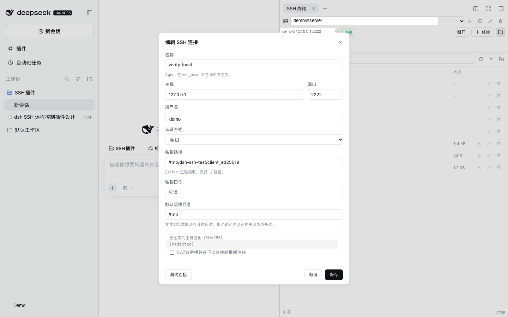

[English](README.en.md) | 中文

# DSH SSH 插件

在 DeepSeek Harness 里连接远程服务器：**SSH 终端和 SFTP 文件管理器直接开在右侧栏**，主对话窗口始终在旁边，不需要退出当前会话。Agent 也可以执行远程命令、上传/下载文件，支持多连接管理与主机密钥固定（TOFU）。

> 包名：`@local/dsh-ssh` · 版本：`0.1.0` · 运行位置：DSH Web / Desktop 的 Host 进程 + Web 客户端


## 功能

- **多连接管理**：名称、主机、端口、用户名、密码/私钥/SSH Agent 三种认证方式；连接状态、错误信息和主机密钥指纹可见。
- **右侧栏终端，对话不中断**：SSH 终端作为右侧栏标签页打开，左侧主对话继续可用；侧栏收起后终端继续运行，展开或刷新页面后自动恢复。
- **交互式终端**：基于 xterm.js 的全功能终端（颜色、Ctrl 组合键、resize、滚动缓冲），每个连接可开多个终端。终端上方实时显示连接状态、↓/↑ 网速、CPU 与内存占用。
- **侧栏入口**：右下角浮动 **SSH** 按钮，或右侧栏的 **+ → SSH 终端** 指南卡片。文件入口是 **+ 终端** 右侧带“文件”文字的文件夹按钮。
- **远程指标**：约每 2 秒采样远端 CPU、内存和网卡计数，换算成下行/上行速率；仅在终端可见时轮询。
- **Agent 远程控制**：`ssh_list` / `ssh_connect` / `ssh_exec` / `ssh_files` / `ssh_upload` / `ssh_download` 六个工具。
- **SFTP 文件管理**：目录浏览、上传（多选/拖拽）、下载、新建目录、重命名、删除；文件夹可一键打包为 `.tar.gz` 下载。
- **传输进度**：上传/下载显示实时进度条与已传输大小，支持取消；文件夹打包下载在没有 `Content-Length` 时显示不确定进度。
- **安全边界**：主机密钥首次连接固定；浏览器 API 走 DSH 已认证的 `/api` 通道；连接凭据只保存在 Host 本地（`0600`），且永远不会回传给浏览器。
- **中英双语**：跟随 DSH 的语言设置（Settings → General）实时切换，不需要刷新页面或改配置。

| 终端（左侧对话始终可见） | 文件管理 |
| --- | --- |
|  |  |




## 安装

本插件按 Workspace 本地包开发，安装后通过 `link:` 进入当前 profile。

### 方式 A：由 Agent 使用 `plugin_manager` 安装（推荐）

在 Creator 模式（或启用了 `tool-plugin-manager` 的 profile）中，对 Agent 说：

```text
用 plugin_manager 的 install_bundle 安装这个本地目录：
/absolute/path/to/SSH插件
```

`install_bundle` 会完成 pnpm 安装与 bundle 选择。安装后刷新页面即可在右下角看到 **SSH** 按钮，或在右侧栏 **+** 菜单里选择 **SSH 终端**。

### 方式 B：手动链接（本机已使用的方式）

DSH Desktop 的 `desktop` profile 由 Electron 独占，`dsh plugin` CLI 拒绝操作，因此需要：

1. 安装依赖并构建客户端：

   ```sh
   pnpm install
   pnpm run build
   ```

2. 在 `$DSH_PROFILE_DIR/package.json` 中加入依赖（先备份）：

   ```json
   { "dependencies": { "@local/dsh-ssh": "link:/绝对路径/SSH插件" } }
   ```

3. 在 profile 目录执行 `pnpm install --ignore-scripts`。

4. 在 `$DSH_PROFILE_DIR/cordis.patch.yml` 末尾加入：

   ```yaml
   - insert:
       - id: ssh
         name: '@local/dsh-ssh'
   ```

5. 重新加载页面（桌面版可重启应用）。HMR 会重组配置并加载 Host 行。

> 手动编辑 profile 会写入工作区之外的文件。请先备份 `package.json`、`pnpm-lock.yaml` 与 `cordis.patch.yml`。

## 使用

### 人工使用

1. 点击右下角 **SSH** 按钮，或右侧栏 **+ → SSH 终端**，在右侧栏打开 SSH。主对话仍在左侧，可以直接继续聊天。
2. 在侧栏顶部选择连接，或点 **+** 新建连接；填写主机、端口、用户名与认证方式，**测试连接** 可先验证。
3. 选中连接后点 **连接**；点 **+ 终端** 打开交互式 Shell，或点 **文件** 管理 SFTP。
4. 侧栏可以收起（终端在 Host 侧继续运行）或拖宽/全屏；刷新页面后仍存活的终端会自动恢复。
5. 首次连接会记录主机密钥指纹；以后指纹变化会拒绝连接，需在编辑连接中显式“忘记该密钥”。

### Agent 使用

工具在插件启用后自动注册。示例对话：

```text
用 ssh_list 看看有哪些服务器；连上 web-1，执行 df -h 和 systemctl status nginx
把本地 dist/ 上传到 web-1 的 /var/www/app/，然后重启服务
把远程 /var/log/nginx/error.log 下载到工作区
```

| 工具 | 作用 | 关键参数 |
| --- | --- | --- |
| `ssh_list` | 列出连接、状态、指纹 | — |
| `ssh_connect` | 预连接或断开 | `connection`、`disconnect` |
| `ssh_exec` | 非交互执行命令 | `connection`、`command`、`timeoutMs`、`pty` |
| `ssh_files` | SFTP 列目录 | `connection`、`path` |
| `ssh_upload` | 本地 → 远程（文件/目录） | `connection`、`localPath`、`remotePath`、`recursive` |
| `ssh_download` | 远程 → 本地（文件/目录） | `connection`、`remotePath`、`localPath`、`recursive` |

约束：

- Agent 的本地路径必须位于当前 Session 工作目录内，防止绕过 DSH 文件沙箱读写任意本地文件。
- 远程路径不受本地沙箱限制；连接本身由用户配置，Agent 不能创建连接或读取/修改凭据。
- 目录传输默认跳过 `.git` 和 `node_modules`，单次最多 1000 个文件。

## 配置

在 `cordis.patch.yml` 的 `ssh` 行上提供 `config`（全部可省略）：

```yaml
- id: ssh
  config:
    dataDir: ~/.dsh/ssh
    connectTimeoutMs: 20000
    execTimeoutMs: 120000
    maxOutputChars: 131072
    maxTerminalChars: 524288
    maxTerminals: 8
    keepaliveIntervalMs: 15000
```

| 字段 | 默认 | 说明 |
| --- | --- | --- |
| `dataDir` | `$DSH_HOME/ssh` | `connections.json` 所在目录 |
| `connectTimeoutMs` | `20000` | SSH 握手超时 |
| `execTimeoutMs` | `120000` | `ssh_exec` 默认超时 |
| `maxOutputChars` | `131072` | 单条命令每个输出流的上限 |
| `maxTerminalChars` | `524288` | 每个终端保留的滚动回看字符数 |
| `maxTerminals` | `8` | 同时存活的交互终端上限 |
| `keepaliveIntervalMs` | `15000` | SSH keepalive 间隔 |

## 安全模型

- **凭据**：连接配置保存在 `$DSH_HOME/ssh/connections.json`，目录 `0700`、文件 `0600`。密码/私钥口令目前是**明文**（仅靠文件权限保护）。优先使用私钥或 SSH Agent；如果使用密码，请确保磁盘加密与账号安全。
- **主机密钥**：首次成功连接采用 TOFU 固定 SHA256 指纹；后续不匹配会拒绝连接并提示重置。
- **浏览器 API**：所有路由挂在 DSH 的 `/api` 之后，沿用浏览器的签名 Cookie 认证与 Host/Origin 校验；不额外开端口、不加未认证路由。
- **数据回传**：列表接口只返回 `hasPassword` / `hasPassphrase` 布尔值，不返回密钥内容。
- **Agent 权限**：Agent 能对已配置连接执行任意远程命令。请只添加确实要交给 Agent 的服务器，并按需使用受限账号。

## 已知限制

- 终端传输使用长轮询（最长 8 秒一次挂起请求），不是 WebSocket；交互延迟通常在几十毫秒，但不适合高帧率全屏程序。
- 指标采集支持 Linux（`/proc`）和 macOS（`sysctl`、`vm_stat`、`top`/`ps`、`netstat`）；其它 Unix 可能只显示部分指标或 `—`。每 2 秒一次，终端不可见时暂停。
- SSH 是右侧栏标签页，依赖当前打开的 DSH 会话；首页没有会话时浮动按钮会隐藏。对话使用的是 DSH 主对话，而不是插件内另建的一套聊天窗口。
- DSH 在窄窗口（<768px）会自动把右侧栏切换为全屏；此时需要拉宽窗口或收起 SSH 侧栏才能同时看到对话。
- Host 进程重启后终端与连接都会丢失；终端滚动缓冲不持久化。
- UI 现在支持文件夹打包下载；目录上传仍通过 Agent 工具的 `recursive` 完成。
- 为显示进度，浏览器会把下载内容先收进内存再触发保存；超大文件/文件夹可能占用较多内存。文件夹打包依赖远端 `tar`。
- 暂不支持端口转发、跳板机/ProxyJump、多跳、密钥生成与管理、sudo 密码交互。
- 凭据未接入 macOS Keychain / Windows Credential Manager。
- 删除非空远程目录需要先用其它方式清空（SFTP `rmdir` 语义）。

## 开发与测试

```sh
pnpm install
pnpm run build          # esbuild 打包 client.js
node test/test-manager.mjs   # Host 管理器（需要本地 sshd）
node test/test-routes.mjs    # HTTP 路由（需要本地 sshd）
node test/test-tools.mjs     # Agent 工具（需要本地 sshd）
node test/test-metrics.mjs   # 指标解析与 CPU/网速差分
node test/test-client.mjs    # jsdom 客户端冒烟
node test/ui-shot.mjs        # Playwright 驱动真实 Web UI（侧栏 + 终端 + 文件 + 收起恢复）
node test/ui-guide.mjs       # 验证右侧栏 + 菜单中的 SSH 指南卡片
```

本机测试用临时 sshd（仅监听 `127.0.0.1:2222`）：

```sh
sh test/setup-local-sshd.sh
```

> macOS 的 `sshd` 在 DSH 文件沙箱内无法初始化自己的 sandbox；启动测试 sshd 时需要在沙箱外执行。

使用 Electron 自带的 Node 运行脚本（本机没有独立 `node`）：

```sh
ELECTRON_RUN_AS_NODE=1 "/Applications/DeepSeek Harness.app/Contents/MacOS/DeepSeek Harness" test/test-manager.mjs
```

## 目录结构

```text
index.js                 Host 插件入口（apply/inject）
host/
  manager.js             连接池、exec、SFTP、交互终端、TOFU
  routes.js              认证的 /api/ssh 路由（JSON、流式上传/下载）
  tools.js               Agent 工具定义
  store.js               connections.json 读写与公开投影
client/src/
  index.jsx              Client 插件入口、样式与 slot 注册
  app.jsx                右侧栏标签、连接选择、终端/文件切换
  terminal.jsx           xterm.js + 长轮询 + resize
  files.jsx              SFTP 文件浏览器
  connection-form.jsx    新建/编辑连接与测试
  ui.jsx / style.js      基础控件与主题样式
client/build.mjs         esbuild → client.js
docs/DESIGN.md           设计说明
test/                    集成测试、UI 测试与本地 sshd 脚本
```

详细设计（数据模型、API、时序、安全与取舍）见 [docs/DESIGN.md](docs/DESIGN.md)。
